<div align="center">


# Alexandria's Archives

**AI-reconstructed history, rebuilt block by block in Minecraft.**

[](https://github.com/Dav1dMathew/alexandrias-archives/actions/workflows/build.yml)
[](LICENSE)


</div>

---

## What is this?

**Alexandria's Archives** (project codename **AEGIS**) turns a text prompt, an image, or a real blueprint of a historical or real-world structure into a **navigable, walkable 3D reconstruction inside Minecraft**.

Give it a building. An AI service infers its geometry, a backend orchestrates the pipeline, and a Fabric mod builds the result directly into the Minecraft world — brick by brick — so you can walk through history instead of just reading about it.

Planned features on top of the core reconstruction:

- 🏛️ **Three scale tiers** — Mini, life-sized, and "megalophobia-esque" oversized builds
- 🕰️ **Timeline generation** — auto-generated growth and economic development across historical periods
- 🧭 **Evidence vs. inference labelling** — see clearly what's historically documented vs. AI-guessed
- 👻 **Historical ghosts** — villagers standing in for the people who once lived there
- 📸 **Photo mode** — for capturing and sharing reconstructions
- 🥽 **Voice / prompt input**, with VR-style interaction as a stretch goal

## How it works

<p align="center">
  
</p>

Three services speak a shared JSON **Blueprint** contract:

| Stage | Service | Role |
|---|---|---|
| 1 | **Fabric Mod** (Java, this repo's `src/`) | Reads the player's `/aa build` prompt, sends the request, validates and places the returned structure in the world tick-by-tick |
| 2 | **Spring Boot backend** (`:8080`) | Orchestrates the request — receives it from the mod and forwards it to the AI service |
| 3 | **FastAPI AI service** (`:8000`, this repo's [`ai-service/`](ai-service)) | Analyzes the prompt/image and returns a structured `Blueprint` (dimensions + block list) |

The mod then validates the blueprint (`BlueprintValidator`) against sane size/block-count limits, and places it into the world in rate-limited batches (`BuildJob`) so large AI-generated builds don't freeze the server.

## Repository layout

```
alexandrias-archives/
├── src/main/java/.../alexandriasarchives/
│   ├── commands/       # /aa, /aa build, /aa image, /aa history, /aa photo
│   ├── builder/         # BlueprintValidator, StructureBuilder, BuildJob (tick-batched placement)
│   └── model/            # Blueprint, BlueprintBlock — the shared structure format
├── ai-service/          # Python FastAPI mock reconstruction service
│   ├── main.py           # GET /health, POST /analyze
│   └── requirements.txt
└── docs/
    └── architecture-diagram.svg
```

## Getting started

### Minecraft mod

See the [Fabric documentation](https://docs.fabricmc.net/develop/getting-started/creating-a-project#setting-up) for IDE setup, then:

```bash
./gradlew runClient
```

Once in a world, `/aa build demo` places a small hardcoded structure so you can confirm the pipeline works end-to-end.

### AI service

```bash
cd ai-service
python3 -m venv .venv && source .venv/bin/activate
pip install -r requirements.txt
uvicorn main:app --reload --port 8000
```

Visit `http://localhost:8000/docs` for the interactive Swagger UI. `/analyze` currently returns a fixed mock `Blueprint` — real reconstruction logic lands later.

## Status

This is an early-stage, in-progress project. The mod can validate and place a hardcoded demo structure, and the AI service returns mock data matching the shared Blueprint schema — but the mod and the AI/backend services aren't wired together yet, and the real reconstruction model doesn't exist. See the project's weekly goals for the current roadmap.

## Team

| Role | Author |
|---|---|
| Minecraft Integration | David Mathew |
| Spring Boot API | Maayan Hazra |
| Python AI Engineer | Jyotishk Ajmera |
| Python AI Programmer | Akshat Barjatya |

## License

This project builds on the Fabric example mod template, available under [CC0](LICENSE). Feel free to learn from it and incorporate it into your own projects.
